# ACC45 – Abhängigkeiten und kritische Pfade

Erzeugt von `werkzeug/acc45-backlog.mjs` aus `docs/acc45/work-packages.json` (nicht von Hand ändern).

**Kritischer Pfad gemeinsam** (offener Entwicklungsaufwand, ohne extern): WP-I10 → WP-I12 → WP-I13 → WP-I17 → WP-I19 → WP-I27 → WP-I37 = **75,4–129,8 PT**
**Ohne Intelligence:** WP-19.0 → WP-19.1 → WP-19.2 → WP-19.3 → WP-19.13 → WP-42a → WP-42 = **24,8–38,7 PT**
**Offener Entwicklungsaufwand:** 439,2–748,5 PT in 88 Paketen (zuzüglich 34 externe Abnahmen/Entscheidungen)

WP-09 ist nur Livegang-Reihenfolge und zählt im Pfad nicht als Abhängigkeit. Der Graph zeigt nur offene Pakete.

```mermaid
flowchart LR
  subgraph acc45[ACC45]
    WP_09["WP-09<br/>IN_PROGRESS"]
    WP_15["WP-15<br/>READY"]
    WP_16["WP-16<br/>REVIEW"]
    WP_18["WP-18<br/>BLOCKED"]
    WP_19["WP-19<br/>IN_PROGRESS"]
    WP_21["WP-21<br/>BLOCKED"]
    WP_30["WP-30<br/>BLOCKED"]
    WP_33["WP-33<br/>REVIEW"]
    WP_34["WP-34<br/>BLOCKED"]
    WP_35["WP-35<br/>BLOCKED"]
    WP_36["WP-36<br/>BLOCKED"]
    WP_38["WP-38<br/>READY"]
    WP_39["WP-39<br/>READY"]
    WP_40["WP-40<br/>BLOCKED"]
    WP_42["WP-42<br/>BLOCKED"]
    WP_44["WP-44<br/>BLOCKED"]
    WP_16c["WP-16c<br/>BLOCKED"]
    WP_32d["WP-32d<br/>READY"]
    WP_42a["WP-42a<br/>BLOCKED"]
    WP_48["WP-48<br/>BLOCKED"]
    SI_P1["SI-P1<br/>READY"]
    SI_P2["SI-P2<br/>READY"]
    SI_P3["SI-P3<br/>READY"]
    SI_P4["SI-P4<br/>READY"]
    SI_P5["SI-P5<br/>READY"]
    SI_P6["SI-P6<br/>READY"]
    SI_P7["SI-P7<br/>READY"]
    SI_P8["SI-P8<br/>READY"]
  end
  subgraph wp19[WP-19-Module]
    WP_19_0["WP-19.0<br/>REVIEW"]
    WP_19_1["WP-19.1<br/>BLOCKED"]
    WP_19_2["WP-19.2<br/>BLOCKED"]
    WP_19_3["WP-19.3<br/>BLOCKED"]
    WP_19_4["WP-19.4<br/>BLOCKED"]
    WP_19_5["WP-19.5<br/>BLOCKED"]
    WP_19_6["WP-19.6<br/>BLOCKED"]
    WP_19_7["WP-19.7<br/>BLOCKED"]
    WP_19_8["WP-19.8<br/>BLOCKED"]
    WP_19_9["WP-19.9<br/>BLOCKED"]
    WP_19_10["WP-19.10<br/>BLOCKED"]
    WP_19_11["WP-19.11<br/>BLOCKED"]
    WP_19_12["WP-19.12<br/>BLOCKED"]
    WP_19_13["WP-19.13<br/>BLOCKED"]
    WP_19_R["WP-19.R<br/>BLOCKED"]
  end
  subgraph intelligence[Intelligence]
    WP_I1["WP-I1<br/>BLOCKED"]
    WP_I2["WP-I2<br/>READY"]
    WP_I3["WP-I3<br/>READY"]
    WP_I4["WP-I4<br/>BLOCKED"]
    WP_I5["WP-I5<br/>BLOCKED"]
    WP_I6["WP-I6<br/>READY"]
    WP_I7["WP-I7<br/>BLOCKED"]
    WP_I8["WP-I8<br/>BLOCKED"]
    WP_I9["WP-I9<br/>BLOCKED"]
    WP_I10["WP-I10<br/>REVIEW"]
    WP_I12["WP-I12<br/>BLOCKED"]
    WP_I13["WP-I13<br/>BLOCKED"]
    WP_I14["WP-I14<br/>BLOCKED"]
    WP_I15["WP-I15<br/>BLOCKED"]
    WP_I16["WP-I16<br/>BLOCKED"]
    WP_I17["WP-I17<br/>BLOCKED"]
    WP_I18["WP-I18<br/>BLOCKED"]
    WP_I19["WP-I19<br/>BLOCKED"]
    WP_I20["WP-I20<br/>BLOCKED"]
    WP_I21["WP-I21<br/>BLOCKED"]
    WP_I22["WP-I22<br/>BLOCKED"]
    WP_I23["WP-I23<br/>BLOCKED"]
    WP_I24["WP-I24<br/>BLOCKED"]
    WP_I25["WP-I25<br/>BLOCKED"]
    WP_I26["WP-I26<br/>BLOCKED"]
    WP_I27["WP-I27<br/>BLOCKED"]
    WP_I28["WP-I28<br/>BLOCKED"]
    WP_I29["WP-I29<br/>BLOCKED"]
    WP_I30["WP-I30<br/>BLOCKED"]
    WP_I31["WP-I31<br/>BLOCKED"]
    WP_I32["WP-I32<br/>BLOCKED"]
    WP_I33["WP-I33<br/>BLOCKED"]
    WP_I34["WP-I34<br/>BLOCKED"]
    WP_I36["WP-I36<br/>BLOCKED"]
    WP_I37["WP-I37<br/>BLOCKED"]
  end
  subgraph folge[Folgepakete]
    WP_14c["WP-14c<br/>BLOCKED"]
    WP_27c["WP-27c<br/>READY"]
    WP_47b["WP-47b<br/>READY"]
    WP_16b["WP-16b<br/>BLOCKED"]
    WP_24b["WP-24b<br/>BLOCKED"]
    WP_28b["WP-28b<br/>IN_PROGRESS"]
    WP_28c["WP-28c<br/>BLOCKED"]
    WP_07b["WP-07b<br/>BLOCKED"]
    WP_S1["WP-S1<br/>READY"]
    WP_PILOT["WP-PILOT<br/>IN_PROGRESS"]
  end
  subgraph extern[Extern/Entscheidungen]
    E_1["E-1<br/>BLOCKED"]
    E_2["E-2<br/>BLOCKED"]
    E_3["E-3<br/>BLOCKED"]
    E_4["E-4<br/>BLOCKED"]
    E_5["E-5<br/>BLOCKED"]
    E_6["E-6<br/>BLOCKED"]
    E_7["E-7<br/>READY"]
    E_8["E-8<br/>READY"]
    E_9["E-9<br/>READY"]
    E_10["E-10<br/>BLOCKED"]
    E_11["E-11<br/>READY"]
    E_12["E-12<br/>READY"]
    E_13["E-13<br/>READY"]
    E_14["E-14<br/>BLOCKED"]
    E_15["E-15<br/>READY"]
    E_16["E-16<br/>READY"]
    E_17a["E-17a<br/>READY"]
    E_17["E-17<br/>BLOCKED"]
    E_18["E-18<br/>BLOCKED"]
    E_19["E-19<br/>READY"]
    E_20["E-20<br/>READY"]
    E_21["E-21<br/>READY"]
    E_22["E-22<br/>READY"]
    E_23["E-23<br/>BLOCKED"]
    E_24["E-24<br/>BLOCKED"]
    E_24i["E-24i<br/>BLOCKED"]
    E_25["E-25<br/>BLOCKED"]
    E_26["E-26<br/>BLOCKED"]
    E_27["E-27<br/>BLOCKED"]
    E_28["E-28<br/>BLOCKED"]
    E_29["E-29<br/>BLOCKED"]
    E_30["E-30<br/>READY"]
    E_31["E-31<br/>READY"]
    E_32["E-32<br/>READY"]
  end
  WP_30 --> WP_18
  WP_19_13 --> WP_19
  WP_39 --> WP_21
  E_9 --> WP_30
  WP_39 --> WP_35
  E_32 --> WP_36
  WP_39 --> WP_40
  WP_42a --> WP_42
  E_1 --> WP_42
  E_2 --> WP_42
  E_3 --> WP_42
  E_4 --> WP_42
  E_5 --> WP_42
  E_6 --> WP_42
  E_7 --> WP_42
  E_8 --> WP_42
  E_11 --> WP_42
  E_12 --> WP_42
  E_13 --> WP_42
  E_14 --> WP_42
  E_15 --> WP_42
  E_17 --> WP_42
  E_18 --> WP_42
  E_21 --> WP_42
  E_22 --> WP_42
  E_9 --> WP_42
  E_10 --> WP_42
  E_29 --> WP_42
  E_30 --> WP_42
  E_32 --> WP_42
  E_15 --> WP_44
  WP_16 --> WP_16c
  WP_15 --> WP_42a
  WP_16 --> WP_42a
  WP_19 --> WP_42a
  WP_21 --> WP_42a
  WP_33 --> WP_42a
  WP_35 --> WP_42a
  WP_38 --> WP_42a
  WP_39 --> WP_42a
  WP_40 --> WP_42a
  WP_44 --> WP_42a
  WP_14c --> WP_42a
  WP_27c --> WP_42a
  WP_47b --> WP_42a
  WP_16b --> WP_42a
  WP_24b --> WP_42a
  WP_28b --> WP_42a
  WP_07b --> WP_42a
  WP_S1 --> WP_42a
  WP_16c --> WP_42a
  WP_32d --> WP_42a
  WP_30 --> WP_42a
  WP_16 --> WP_48
  WP_16 --> WP_14c
  WP_16 --> WP_16b
  E_21 --> WP_24b
  WP_16 --> WP_07b
  WP_19_0 --> WP_19_1
  WP_19_0 --> WP_19_2
  WP_19_1 --> WP_19_2
  WP_19_1 --> WP_19_3
  WP_19_2 --> WP_19_3
  WP_16 --> WP_19_3
  WP_19_0 --> WP_19_4
  WP_19_0 --> WP_19_5
  WP_19_4 --> WP_19_5
  WP_19_0 --> WP_19_6
  WP_16 --> WP_19_6
  WP_19_7 --> WP_19_6
  WP_16 --> WP_19_7
  WP_19_4 --> WP_19_8
  WP_19_0 --> WP_19_9
  WP_19_4 --> WP_19_9
  WP_19_8 --> WP_19_9
  WP_19_0 --> WP_19_10
  WP_19_10 --> WP_19_11
  WP_19_0 --> WP_19_11
  WP_19_0 --> WP_19_12
  WP_19_0 --> WP_19_13
  WP_19_1 --> WP_19_13
  WP_19_2 --> WP_19_13
  WP_19_3 --> WP_19_13
  WP_19_4 --> WP_19_13
  WP_19_5 --> WP_19_13
  WP_19_6 --> WP_19_13
  WP_19_7 --> WP_19_13
  WP_19_8 --> WP_19_13
  WP_19_9 --> WP_19_13
  WP_19_10 --> WP_19_13
  WP_19_11 --> WP_19_13
  WP_19_12 --> WP_19_13
  E_21 --> WP_I1
  WP_I3 --> WP_I4
  WP_I3 --> WP_I5
  WP_I4 --> WP_I5
  WP_I3 --> WP_I7
  WP_I5 --> WP_I7
  WP_I6 --> WP_I7
  WP_I7 --> WP_I8
  WP_I7 --> WP_I9
  WP_I8 --> WP_I9
  WP_I10 --> WP_I12
  WP_I12 --> WP_I13
  WP_I13 --> WP_I14
  WP_I13 --> WP_I15
  WP_I13 --> WP_I16
  WP_I15 --> WP_I16
  WP_I13 --> WP_I17
  WP_I13 --> WP_I18
  E_25 --> WP_I18
  WP_I13 --> WP_I19
  WP_I17 --> WP_I19
  WP_I12 --> WP_I19
  WP_I12 --> WP_I20
  WP_I13 --> WP_I20
  WP_I15 --> WP_I20
  WP_I17 --> WP_I20
  WP_I19 --> WP_I21
  WP_I20 --> WP_I21
  E_24i --> WP_I21
  WP_I12 --> WP_I22
  WP_I13 --> WP_I22
  WP_I17 --> WP_I22
  WP_I13 --> WP_I23
  WP_I17 --> WP_I23
  WP_I12 --> WP_I24
  WP_I13 --> WP_I24
  WP_I17 --> WP_I24
  WP_I3 --> WP_I25
  WP_I4 --> WP_I25
  WP_I13 --> WP_I25
  WP_I3 --> WP_I26
  WP_I8 --> WP_I26
  WP_I13 --> WP_I26
  WP_I19 --> WP_I27
  WP_I16 --> WP_I27
  E_25 --> WP_I27
  E_26 --> WP_I27
  WP_I12 --> WP_I28
  WP_I13 --> WP_I28
  WP_I19 --> WP_I28
  WP_I13 --> WP_I29
  WP_I15 --> WP_I29
  WP_I12 --> WP_I29
  WP_I13 --> WP_I30
  WP_I17 --> WP_I30
  WP_I12 --> WP_I31
  WP_I13 --> WP_I31
  WP_I28 --> WP_I32
  WP_I28 --> WP_I33
  WP_I8 --> WP_I34
  WP_I9 --> WP_I34
  WP_I13 --> WP_I34
  E_27 --> WP_I34
  WP_I9 --> WP_I36
  WP_I16 --> WP_I36
  WP_I1 --> WP_I37
  WP_I2 --> WP_I37
  WP_I3 --> WP_I37
  WP_I4 --> WP_I37
  WP_I5 --> WP_I37
  WP_I6 --> WP_I37
  WP_I7 --> WP_I37
  WP_I8 --> WP_I37
  WP_I9 --> WP_I37
  WP_I10 --> WP_I37
  WP_I12 --> WP_I37
  WP_I13 --> WP_I37
  WP_I14 --> WP_I37
  WP_I15 --> WP_I37
  WP_I16 --> WP_I37
  WP_I17 --> WP_I37
  WP_I18 --> WP_I37
  WP_I19 --> WP_I37
  WP_I20 --> WP_I37
  WP_I21 --> WP_I37
  WP_I22 --> WP_I37
  WP_I23 --> WP_I37
  WP_I24 --> WP_I37
  WP_I25 --> WP_I37
  WP_I26 --> WP_I37
  WP_I27 --> WP_I37
  WP_I28 --> WP_I37
  WP_I29 --> WP_I37
  WP_I30 --> WP_I37
  WP_I31 --> WP_I37
  WP_I32 --> WP_I37
  WP_I33 --> WP_I37
  WP_I34 --> WP_I37
  WP_I36 --> WP_I37
  E_28 --> WP_I37
  E_24i --> WP_I37
  WP_42a --> E_1
  WP_S1 --> E_1
  E_16 --> E_1
  E_1 --> E_2
  E_1 --> E_3
  E_1 --> E_4
  E_1 --> E_5
  E_1 --> E_6
  WP_32d --> E_10
  E_13 --> E_14
  E_1 --> E_17
  E_17a --> E_17
  WP_36 --> E_18
  WP_42 --> E_23
  E_23 --> E_24
  E_31 --> E_24
  E_24 --> E_24i
  WP_16c --> E_29
  WP_19_0 --> WP_19_R
  WP_19_4 --> WP_19_R
  WP_S1 --> WP_PILOT
  WP_19_0 --> WP_PILOT
  E_19 --> WP_PILOT
```

| Paket | Strang | Prio | PT | Rest-PT | hängt ab von | Konfliktzonen | Modell | Status |
|---|---|---|---|---|---|---|---|---|
| WP-01 | acc45 | P0 | 1–1,5 | 0 | – | – | sonnet | DONE |
| WP-02 | acc45 | P0 | 2,5–3,5 | 0 | – | – | opus | INTEGRATED |
| WP-03 | acc45 | P0 | 1,5–2,5 | 0 | – | – | sonnet | INTEGRATED |
| WP-04 | acc45 | P0 | 3,5–5 | 0 | – | – | sonnet | INTEGRATED |
| WP-05 | acc45 | P0 | 3–4,5 | 0 | WP-04, WP-30 | – | sonnet | INTEGRATED |
| WP-06 | acc45 | P0 | 4–5,5 | 0 | WP-02 | – | opus | INTEGRATED |
| WP-07 | acc45 | P0 | 7–9,5 | 0 | WP-02, WP-06, WP-17 | – | opus | INTEGRATED |
| WP-08 | acc45 | P0 | 0,5–1 | 0 | – | – | sonnet | DONE |
| WP-09 | acc45 | P1 | 2–3 | 0,5–1 | WP-02 | – | opus | IN_PROGRESS |
| WP-10 | acc45 | P1 | 6–8,5 | 0 | WP-09 | – | opus | INTEGRATED |
| WP-11 | acc45 | P1 | 4–5,5 | 0 | WP-10 | – | opus | INTEGRATED |
| WP-12 | acc45 | P1 | 2–3 | 0 | WP-11 | – | sonnet | INTEGRATED |
| WP-13 | acc45 | P1 | 3–4,5 | 0 | WP-06 | – | sonnet | INTEGRATED |
| WP-14 | acc45 | P1 | 6–8,5 | 0 | WP-06 | – | opus | INTEGRATED |
| WP-15 | acc45 | P1 | 3–4,5 | 3–4,5 | WP-14 | App.jsx, daten.mjs | opus | READY |
| WP-16 | acc45 | P1 | 5–7 | 0,5–1,5 | WP-06, WP-14 | App.jsx, daten.mjs, stempelintegritaet.mjs, package.json | opus | REVIEW |
| WP-17 | acc45 | P1 | 2–3 | 0 | WP-02 | – | opus | INTEGRATED |
| WP-18 | acc45 | P1 | 6–8,5 | 6–8,5 | WP-30, WP-09 | App.jsx, rechte.mjs, daten.mjs | opus | BLOCKED |
| WP-19 | acc45 | P1 | 0 | 0 | WP-11, WP-22, WP-19.13 | – | siehe WP-19.x | IN_PROGRESS |
| WP-20 | acc45 | P1 | 6–8,5 | 0 | WP-06 | – | sonnet | INTEGRATED |
| WP-21 | acc45 | P1 | 10–13,5 | 10–13,5 | WP-12, WP-39 | App.jsx | sonnet | BLOCKED |
| WP-22 | acc45 | P2 | 6–8,5 | 0 | WP-11 | – | opus | INTEGRATED |
| WP-23 | acc45 | P2 | 1–1,5 | 0 | WP-43 | – | opus | INTEGRATED |
| WP-24 | acc45 | P2 | 2–3 | 0 | WP-43 | – | opus | INTEGRATED |
| WP-25 | acc45 | P2 | 2–3 | 0 | WP-43 | – | sonnet | INTEGRATED |
| WP-26 | acc45 | P2 | 4–5,5 | 0 | WP-09 | – | opus | INTEGRATED |
| WP-27 | acc45 | P2 | 4–5,5 | 0 | WP-43 | – | opus | INTEGRATED |
| WP-28 | acc45 | P2 | 3–4,5 | 0 | WP-02, WP-17 | – | sonnet | INTEGRATED |
| WP-29 | acc45 | P2 | 3–4,5 | 0 | WP-20 | – | sonnet | INTEGRATED |
| WP-30 | acc45 | P2 | 2–3 | 2–3 | E-9 | – | sonnet | BLOCKED |
| WP-31 | acc45 | P2 | 4–5,5 | 0 | WP-03 | – | sonnet | INTEGRATED |
| WP-32 | acc45 | P2 | 3–4,5 | 0 | – | – | sonnet | INTEGRATED |
| WP-33 | acc45 | P2 | 5–7 | 1,5–3 | – | package.json | sonnet | REVIEW |
| WP-34 | acc45 | P2 | 1–1,5 | 1–1,5 | WP-09 | – | sonnet | BLOCKED |
| WP-35 | acc45 | P3 | 2–3 | 2–3 | WP-39 | App.jsx | sonnet | BLOCKED |
| WP-36 | acc45 | P3 | 1–1,5 | 1–1,5 | E-32 | – | sonnet | BLOCKED |
| WP-37 | acc45 | P3 | 1,5–2,5 | 0 | WP-43 | – | sonnet | INTEGRATED |
| WP-38 | acc45 | P3 | 2–3 | 2–3 | WP-12 | App.jsx | sonnet | READY |
| WP-39 | acc45 | P3 | 4–5,5 | 4–5,5 | WP-12 | App.jsx | sonnet | READY |
| WP-40 | acc45 | P3 | 3–4,5 | 3–4,5 | WP-39 | App.jsx | sonnet | BLOCKED |
| WP-41 | acc45 | P3 | 2–3 | 0 | WP-04, WP-05, WP-31 | – | sonnet | INTEGRATED |
| WP-42 | acc45 | P1 | 3–4,5 | 3–4,5 | WP-42a, E-1, E-2, E-3, E-4, E-5, E-6, E-7, E-8, E-11, E-12, E-13, E-14, E-15, E-17, E-18, E-21, E-22, E-9, E-10, E-29, E-30, E-32 | – | opus | BLOCKED |
| WP-43 | acc45 | P0 | 2–3 | 0 | WP-09 | – | opus | INTEGRATED |
| WP-45 | acc45 | P0 | 2–3 | 0 | WP-02 | – | opus | INTEGRATED |
| WP-46 | acc45 | P0 | 1–1,5 | 0 | WP-02 | – | opus | INTEGRATED |
| WP-47 | acc45 | P0 | 1–1,5 | 0 | WP-46 | – | opus | INTEGRATED |
| WP-44 | acc45 | P0 | 0,5–1 | 0,5–1 | E-15 | – | opus | BLOCKED |
| WP-16c | acc45 | P0 | 6–10 | 6–10 | WP-16 | App.jsx, daten.mjs, stempelintegritaet.mjs | opus | BLOCKED |
| WP-32d | acc45 | P0 | 1–2 | 1–2 | WP-32 | – | opus | READY |
| WP-42a | acc45 | P1 | 1–2 | 1–2 | WP-07, WP-09, WP-12, WP-15, WP-16, WP-19, WP-21, WP-33, WP-35, WP-38, WP-39, WP-40, WP-41, WP-43, WP-44, WP-45, WP-46, WP-14c, WP-27c, WP-47b, WP-16b, WP-24b, WP-28b, WP-07b, WP-S1, WP-16c, WP-32d, WP-30 | – | opus | BLOCKED |
| WP-48 | acc45 | P0 | 16–26 | 16–26 | WP-16 | daten.mjs, rechte.mjs, App.jsx, stempelintegritaet.mjs | opus | BLOCKED |
| WP-14c | folge | P1 | 3–5 | 3–5 | WP-14, WP-16 | App.jsx, daten.mjs | opus | BLOCKED |
| WP-27c | folge | P2 | 1,5–3 | 1,5–3 | WP-27 | – | opus | READY |
| WP-47b | folge | P2 | 2–4 | 2–4 | WP-47, WP-24 | daten.mjs | opus | READY |
| WP-16b | folge | P2 | 0,5–1,5 | 0,5–1,5 | WP-16 | daten.mjs | opus | BLOCKED |
| WP-24b | folge | P2 | 1,5–3 | 1,5–3 | WP-24, E-21 | – | opus | BLOCKED |
| WP-28b | folge | P2 | 1,5–3 | 0,5–1 | WP-28, WP-47 | – | sonnet | IN_PROGRESS |
| WP-28c | folge | P2 | 3–5 | 3–5 | – | daten.mjs | opus | BLOCKED |
| WP-07b | folge | P1 | 2–4 | 2–4 | WP-07, WP-16 | daten.mjs, stempelintegritaet.mjs | opus | BLOCKED |
| WP-S1 | folge | P1 | 1–2 | 1–2 | WP-12 | – | sonnet | READY |
| WP-19.0 | wp19 | P1 | 4–6 | 0,8–1,2 | WP-11, WP-22 | App.jsx, rechte.mjs, sicht.mjs | opus | REVIEW |
| WP-19.1 | wp19 | P1 | 4–6 | 4–6 | WP-19.0 | – | sonnet + opus-review | BLOCKED |
| WP-19.2 | wp19 | P1 | 8–12 | 8–12 | WP-19.0, WP-19.1, WP-26 | rechte.mjs | opus | BLOCKED |
| WP-19.3 | wp19 | P1 | 5–8 | 5–8 | WP-19.1, WP-19.2, WP-16 | – | opus | BLOCKED |
| WP-19.4 | wp19 | P1 | 4–6 | 4–6 | WP-19.0 | – | sonnet + opus-review | BLOCKED |
| WP-19.5 | wp19 | P1 | 4–6 | 4–6 | WP-19.0, WP-19.4 | – | sonnet + opus-review | BLOCKED |
| WP-19.6 | wp19 | P1 | 8–12 | 8–12 | WP-19.0, WP-16, WP-19.7 | daten.mjs | opus | BLOCKED |
| WP-19.7 | wp19 | P1 | 7–11 | 7–11 | WP-16, WP-07 | daten.mjs, stempelintegritaet.mjs | opus | BLOCKED |
| WP-19.8 | wp19 | P1 | 4–6 | 4–6 | WP-19.4 | – | sonnet | BLOCKED |
| WP-19.9 | wp19 | P1 | 6–9 | 6–9 | WP-19.0, WP-19.4, WP-19.8, WP-43 | sicht.mjs, rechte.mjs | opus | BLOCKED |
| WP-19.10 | wp19 | P1 | 2–3 | 2–3 | WP-19.0 | – | sonnet | BLOCKED |
| WP-19.11 | wp19 | P1 | 2–4 | 2–4 | WP-19.10, WP-19.0 | – | sonnet | BLOCKED |
| WP-19.12 | wp19 | P1 | 2–4 | 2–4 | WP-19.0 | App.jsx | sonnet | BLOCKED |
| WP-19.13 | wp19 | P1 | 3–5 | 3–5 | WP-19.0, WP-19.1, WP-19.2, WP-19.3, WP-19.4, WP-19.5, WP-19.6, WP-19.7, WP-19.8, WP-19.9, WP-19.10, WP-19.11, WP-19.12 | – | opus (Rechte/Daten) / sonnet | BLOCKED |
| WP-I1 | intelligence | P2 | 2–6 | 2–6 | E-21, WP-22, E-21i | – | sonnet + opus-review | BLOCKED |
| WP-I2 | intelligence | P2 | 3–6 | 3–6 | WP-11, E-21i | App.jsx | sonnet | READY |
| WP-I3 | intelligence | P2 | 8–14 | 8–14 | WP-11, E-21i | – | sonnet | READY |
| WP-I4 | intelligence | P2 | 8–14 | 8–14 | WP-I3, WP-22 | App.jsx, rechte.mjs | sonnet + opus-review | BLOCKED |
| WP-I5 | intelligence | P2 | 4–8 | 4–8 | WP-I3, WP-I4 | App.jsx | sonnet | BLOCKED |
| WP-I6 | intelligence | P2 | 3–5 | 3–5 | E-21i | App.jsx | sonnet | READY |
| WP-I7 | intelligence | P2 | 14–26 | 14–26 | WP-I3, WP-I5, WP-I6 | – | sonnet | BLOCKED |
| WP-I8 | intelligence | P2 | 8–14 | 8–14 | WP-I7 | App.jsx | sonnet | BLOCKED |
| WP-I9 | intelligence | P2 | 7–12 | 7–12 | WP-I7, WP-I8 | App.jsx | sonnet + opus-review | BLOCKED |
| WP-I10 | intelligence | P3 | 2–4 | 0,4–0,8 | E-21i | – | sonnet | REVIEW |
| WP-I11 | intelligence | P3 | 6–10 | 0 | WP-43, WP-I10 | – | opus | INTEGRATED |
| WP-I12 | intelligence | P3 | 14–24 | 14–24 | WP-11, WP-22, WP-I10 | App.jsx | sonnet | BLOCKED |
| WP-I13 | intelligence | P3 | 14–24 | 14–24 | WP-I11, WP-I12 | – | sonnet + opus-review | BLOCKED |
| WP-I14 | intelligence | P3 | 5–8 | 5–8 | WP-I13 | – | sonnet + opus-review | BLOCKED |
| WP-I15 | intelligence | P3 | 8–14 | 8–14 | WP-I13, WP-05 | – | sonnet + opus-review | BLOCKED |
| WP-I16 | intelligence | P3 | 8–14 | 8–14 | WP-I13, WP-I15 | App.jsx, rechte.mjs | opus | BLOCKED |
| WP-I17 | intelligence | P3 | 6–10 | 6–10 | WP-I13 | App.jsx | sonnet | BLOCKED |
| WP-I18 | intelligence | P3 | 2–4 | 2–4 | WP-I13, E-25 | – | sonnet | BLOCKED |
| WP-I19 | intelligence | P3 | 16–28 | 16–28 | WP-I13, WP-I17, WP-I12 | App.jsx | sonnet + opus-review | BLOCKED |
| WP-I20 | intelligence | P3 | 16–28 | 16–28 | WP-I12, WP-I13, WP-I15, WP-I17 | App.jsx | sonnet + opus-review | BLOCKED |
| WP-I21 | intelligence | P3 | 8–14 | 8–14 | WP-I19, WP-I20, E-24i | – | sonnet | BLOCKED |
| WP-I22 | intelligence | P3 | 8–14 | 8–14 | WP-I12, WP-I13, WP-I17 | App.jsx | sonnet | BLOCKED |
| WP-I23 | intelligence | P3 | 4–7 | 4–7 | WP-I13, WP-I17 | – | haiku + sonnet | BLOCKED |
| WP-I24 | intelligence | P3 | 5–9 | 5–9 | WP-I12, WP-I13, WP-I17 | App.jsx | sonnet | BLOCKED |
| WP-I25 | intelligence | P3 | 7–12 | 7–12 | WP-I3, WP-I4, WP-I13 | – | sonnet | BLOCKED |
| WP-I26 | intelligence | P3 | 8–14 | 8–14 | WP-I3, WP-I8, WP-I13 | – | sonnet | BLOCKED |
| WP-I27 | intelligence | P3 | 20–34 | 20–34 | WP-I19, WP-I16, E-25, E-26 | – | opus | BLOCKED |
| WP-I28 | intelligence | P3 | 12–20 | 12–20 | WP-I12, WP-I13, WP-I19 | App.jsx | sonnet | BLOCKED |
| WP-I29 | intelligence | P3 | 18–30 | 18–30 | WP-I13, WP-I15, WP-I12 | App.jsx | sonnet | BLOCKED |
| WP-I30 | intelligence | P3 | 4–8 | 4–8 | WP-I13, WP-I17 | App.jsx | sonnet | BLOCKED |
| WP-I31 | intelligence | P3 | 9–15 | 9–15 | WP-I12, WP-I13 | – | sonnet + opus-review | BLOCKED |
| WP-I32 | intelligence | P3 | 5–9 | 5–9 | WP-I28 | App.jsx | sonnet | BLOCKED |
| WP-I33 | intelligence | P3 | 8–14 | 8–14 | WP-I28 | App.jsx | sonnet | BLOCKED |
| WP-I34 | intelligence | P3 | 8–14 | 8–14 | WP-I8, WP-I9, WP-I13, E-27 | – | sonnet + opus-review | BLOCKED |
| WP-I35 | intelligence | P3 | 15–28 | 0 | WP-I15, E-21i | – | sonnet | BLOCKED |
| WP-I36 | intelligence | P3 | 5–9 | 5–9 | WP-I9, WP-I16 | App.jsx | sonnet | BLOCKED |
| WP-I37 | intelligence | P3 | 5–9 | 5–9 | WP-I1, WP-I2, WP-I3, WP-I4, WP-I5, WP-I6, WP-I7, WP-I8, WP-I9, WP-I10, WP-I11, WP-I12, WP-I13, WP-I14, WP-I15, WP-I16, WP-I17, WP-I18, WP-I19, WP-I20, WP-I21, WP-I22, WP-I23, WP-I24, WP-I25, WP-I26, WP-I27, WP-I28, WP-I29, WP-I30, WP-I31, WP-I32, WP-I33, WP-I34, WP-I36, E-28, E-24i | – | opus (Review) / sonnet | BLOCKED |
| E-1 | extern | P1 | 1–2 | 1–2 | WP-42a, WP-S1, E-16 | – | – | BLOCKED |
| E-2 | extern | P1 | 0,25–0,5 | 0,25–0,5 | E-1 | – | – | BLOCKED |
| E-3 | extern | P1 | 0,25–0,5 | 0,25–0,5 | E-1 | – | – | BLOCKED |
| E-4 | extern | P1 | 0,25–0,5 | 0,25–0,5 | E-1 | – | – | BLOCKED |
| E-5 | extern | P1 | 0,5 | 0,5 | E-1 | – | – | BLOCKED |
| E-6 | extern | P1 | 0,25–0,5 | 0,25–0,5 | E-1 | – | – | BLOCKED |
| E-7 | extern | P1 | 0,5–1 | 0,5–1 | WP-04 | – | – | READY |
| E-8 | extern | P1 | 0,25–0,5 | 0,25–0,5 | WP-05 | – | – | READY |
| E-9 | extern | P1 | 0,5–1 | 0,5–1 | – | – | – | READY |
| E-10 | extern | P1 | 0,25 | 0,25 | WP-32, WP-32d | – | – | BLOCKED |
| E-11 | extern | P1 | 0,25–0,5 | 0,25–0,5 | WP-31 | – | – | READY |
| E-12 | extern | P1 | 0,25–0,5 | 0,25–0,5 | WP-32 | – | – | READY |
| E-13 | extern | P1 | 0,25 | 0,25 | WP-03 | – | – | READY |
| E-14 | extern | P1 | 0,25–0,5 | 0,25–0,5 | E-13 | – | – | BLOCKED |
| E-15 | extern | P2 | 0,25–0,5 | 0,25–0,5 | – | – | – | READY |
| E-16 | extern | P2 | 0,1 | 0,1 | WP-27 | – | – | READY |
| E-17a | extern | P1 | 0,5–1 | 0,5–1 | – | – | – | READY |
| E-17 | extern | P1 | 3–8 | 3–8 | E-1, E-17a | – | – | BLOCKED |
| E-18 | extern | P1 | 0,5–1 | 0,5–1 | WP-36 | – | – | BLOCKED |
| E-19 | extern | P2 | 0,5–1 | 0,5–1 | – | – | – | READY |
| E-20 | extern | P2 | 0,25–0,5 | 0,25–0,5 | – | – | – | READY |
| E-21 | extern | P2 | 0,5–1 | 0,5–1 | – | – | – | READY |
| E-21i | extern | P2 | 0,5–1 | 0 | – | – | – | DONE |
| E-22 | extern | P2 | 1–3 | 1–3 | – | – | – | READY |
| E-23 | extern | P2 | 0,25–0,5 | 0,25–0,5 | WP-42 | – | – | BLOCKED |
| E-24 | extern | P2 | 1–3 | 1–3 | E-23, E-31 | – | – | BLOCKED |
| E-24i | extern | P2 | 2–5 | 2–5 | E-24, E-21i | – | – | BLOCKED |
| E-25 | extern | P2 | 1–3 | 1–3 | E-21i | – | – | BLOCKED |
| E-26 | extern | P2 | 1–2 | 1–2 | E-21i | – | – | BLOCKED |
| E-27 | extern | P2 | 0,5–1 | 0,5–1 | E-21i | – | – | BLOCKED |
| E-28 | extern | P2 | 0,5–1 | 0,5–1 | E-21i | – | – | BLOCKED |
| E-29 | extern | P0 | 1–2 | 1–2 | WP-16c | – | – | BLOCKED |
| E-30 | extern | P1 | 0,5–1 | 0,5–1 | – | – | – | READY |
| E-31 | extern | P1 | 0,5–1 | 0,5–1 | – | – | – | READY |
| E-32 | extern | P1 | 0,5–1,5 | 0,5–1,5 | – | – | – | READY |
| WP-19.R | wp19 | P1 | 7–11 | 7–11 | WP-19.0, WP-19.4 | – | sonnet + opus-review | BLOCKED |
| WP-PILOT | folge | P2 | 4–8 | 2–4 | WP-S1, WP-19.0, E-19 | – | sonnet | IN_PROGRESS |
| SI-P1 | acc45 | P1 | 1,5–3 | 1,5–3 | – | daten.mjs | opus | READY |
| SI-P2 | acc45 | P1 | 1–2 | 1–2 | – | rechte.mjs | opus | READY |
| SI-P3 | acc45 | P2 | 1–2 | 1–2 | – | – | opus | READY |
| SI-P4 | acc45 | P1 | 3–5 | 3–5 | – | App.jsx, daten.mjs | opus | READY |
| SI-P5 | acc45 | P3 | 1–2 | 1–2 | – | – | opus | READY |
| SI-P6 | acc45 | P0 | 1,5–3 | 1,5–3 | – | daten.mjs | opus | READY |
| SI-P7 | acc45 | P2 | 1,5–2,5 | 1,5–2,5 | – | daten.mjs | opus | READY |
| SI-P8 | acc45 | P2 | 0,5–1 | 0,5–1 | – | – | opus | READY |
