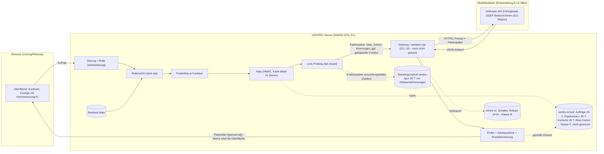

# KI-Datenfluss (CENTRIC Intelligence, F1–F18)

**Stand:** 2026-11-03 · **Art:** Analyse des geplanten Datenflusses, **rechtlich ungeprüft**. Ob einzelne Angaben personenbezogen oder besonders geschützt sind, ist eine rechtliche Bewertung und hier als „zu prüfen“ markiert.

**Grundlagen:**
- Spezifikation: `docs/intelligence/CENTRIC-INTELLIGENCE.md` (CI)
- Plan: `docs/acc45/INTELLIGENCE-ENTWICKLUNGSPLAN.md`
- Architekturabgleich: `docs/intelligence/ARCHITEKTUR-ABGLEICH.md` (AD-nn)
- Faktenpaket-Vertrag im Branch `origin/intelligence/wp-i11-faktenpaket`: `server/lib/intelligence/felder.mjs`, `positivliste.mjs`, `alias.mjs`, `leckpruefung.mjs`, `docs/intelligence/FAKTENPAKET.md`

**Ist-Zustand:** Es gibt **keinen Modellaufruf** im Code. Der WP-I11-Branch baut nur das Faktenpaket. Gateway (I13) und Live-Anbindung (I18) fehlen. Alles unten beschreibt den **geplanten** Fluss nach dem Stand dieser Dokumente.

## 1. Datenflussdiagramm

Für Funktion F7B (PDF, Scan, Foto) gilt ein eigener Sicherheitsbereich. Sie ist **nicht** Teil dieses Flusses und steht nicht in der Positivliste (siehe Abschnitt 4).

## 2. Was an das Modell geht

- **Faktenpaket:** eine flache Liste typisierter Fakten, höchstens 500 (FAKTENPAKET.md 4.1). Erlaubt sind nur Felder aus `felder.mjs`. Je Funktion wählt `positivliste.mjs` davon aus. Grundlage ist die **Sicht der auslösenden Rolle**, geschnitten mit der Positivliste.
- **Alias:** Personen, Einheiten und Objekte erscheinen als `P_`/`E_`/`O_` mit 8 Konsonanten. Gebildet per HMAC-SHA256 mit Unterschlüsseln je Raum und Betrieb und mit Trennung je Kontext (`alias.mjs:1-30`). Die Karte bleibt im Server und lässt sich nicht serialisieren. Die Rückübersetzung ergibt Platzhalter, keine Namen.
- **Nie im Paket** (`felder.mjs:23-28`):
  - Namen, Kürzel, Personalnummer, Kontaktdaten, Anschrift, Geburtsdatum, Ein- und Austritt
  - **Abwesenheitsart und -grund**, Mutterschutz, Schwerbehinderung, Einschränkungen
  - Einwilligungen, Notizen und jeder Freitext außer gekapseltem Fremdtext
  - Stempel- und Ist-Zeiten, Standortdaten, Zugangs-, Kalender- und Push-Daten
  - Lohn und Vertrag
- **Leck-Prüfung:** Die Sperrliste wird aus dem **rohen** Betrieb gebildet, enthält also auch Namen, die die Rolle nicht sieht. Dazu Muster für Kontaktdaten, IBAN, Gesundheits- und Schutzbegriffe, Koordinaten und Token. Bei Verdacht wird das ganze Paket verworfen (FAKTENPAKET.md 7).
- **Wer auslösen darf:** Leitung und Planung. Beschäftigte nur F9 (ohne Betriebsdaten). Betriebsrat und Betreiber nie. Schichtverantwortung und die Kundenrolle bis zur Entscheidung B-5 nicht (`positivliste.mjs:33-37`).

## 3. Funktionen F1–F18

Legende:
- **Pers.:** Das Paket darf Personen-Alias enthalten.
- **Freitext:** gekapselte Eingabe der Nutzerin bzw. Spaltenköpfe.
- **Sensibel:** mögliche Rückschlüsse auf besondere Kategorien (Art. 9 DSGVO) oder auf Verhalten. **Das ist eine Einschätzung, rechtlich zu prüfen.**
- **Zwingend/minimierbar:** Vorschlag, ob die Funktion ohne das Feld auskäme.

Felder je Funktion laut `positivliste.mjs:50-107` (Version 1.0).

| F | Name | Klasse | Pers. | Freitext | Felder mit Personenbezug (Alias) | Sensibel? | Zwingend / minimierbar |
|---|---|---|---|---|---|---|---|
| F1 | Plan-Erklärer | B | ja | nein | Dienst, frei, Einheit, Qualifikation, Wochenstunden, **Abwesenheit (nur „abwesend“)** | Abwesenheit ohne Art ist kein Gesundheitsdatum. Aus Serien kann man aber auf Krankheit schließen, **zu prüfen** | Abwesenheit auf den erklärten Tag beschränken |
| F2 | Regel- und Verstoß-Erklärer | A | ja | nein | Dienst, Ruhezeit, Saldo, Befund | Ein Befund „schutz“ (neutralisiert) zeigt, dass für die Person eine Schutzvorschrift gilt. Möglicher Rückschluss auf Mutterschutz oder Behinderung, **zu prüfen** | Schutzbefunde nicht einzeln je Alias erklären, sondern „nicht einsetzbar“ |
| F3 | Ausfall-Vorschlag | A | ja | nein | wie F1 + Teilzeit, Springer, Schichtdienst, Kandidat (zulässig, Spielraum, Hinderung), Saldo, Ruhezeit | wie F1/F2 (Hinderung „schutz“) | Felder für die Lösungswege zwingend. „schutz“ als Hinderung → generisch „nicht verfügbar“ |
| F4 | Leitungsbriefing | C | nein | nein | – (Kennzahlen, Besetzung) | gering. Bei kleinen Einheiten können Kennzahlen auf Personen zurückführen | Mindestgröße für Kennzahlen (k-Anonymität) prüfen |
| F5 | Nachrichten-Werkstatt | B | nein | **ja** | – | Freitext kann alles enthalten. Die Leck-Prüfung blockiert Namen und Gesundheitsbegriffe aus Liste und Muster, aber nicht vollständig | Eingabewarnung. Freitext nicht speichern (nur Ergebnis) |
| F6 | Fragen an Daten | B | nein | **ja** | – (Kennzahl) | Frage kann Personenbezug enthalten. Krankheitsfragen werden abgelehnt (Plan I31) | wie F5 |
| F7A | Altplan (Tabelle) | D | nein | **ja** (Spaltenköpfe, maskierte Beispiele) | – | Spaltenköpfe wie „Krank“ oder „AU“ möglich | maskieren; Klarnamen bleiben lokal (CI 4.1) |
| F7B | Altplan (PDF/Foto) | – | – | – | **nicht in der Positivliste**; eigener Sicherheitsbereich | **hoch:** Klarnamen und Krankheitsvermerke im Dokument möglich (CI 8.1) | nur nach DSFA, ZDR, Schwärzung, eigener Strecke (CI 4.1, 8.2) |
| F8 | Schichtmodell-Analyse | C | nein | nein | – | gering | – |
| F9 | Hilfe-Assistent | B | nein | **ja** | – (keine Betriebsdaten) | Freitext der Frage | wie F5 |
| F10 | Personalansatz | C | nein | nein | – | gering (wie F4) | wie F4 |
| F11 | Frühwarnungen | C | nein | nein | – | gering. Keine Vorhersage über Einzelne (Plan I29) | wie F4 |
| F12 | Abschluss-Assistent | C | ja | nein | Saldo, Dienst, Befund | Saldo und Befunde je Alias können ein Verhaltensbild ergeben, **zu prüfen** (Mitbestimmung) | Personen nur mit offenem Befund |
| F13 | Planvorschlag | C | ja | nein | wie F3 ohne Kandidat | Arbeit zuweisen: EU-KI-VO Anhang III Nr. 4 b als Prüfpunkt (CI 8.3), Art. 22 DSGVO zu prüfen (Plan 8) | produktiv erst nach externer Einordnung |
| F14 | Was-wäre-wenn | C | ja | nein | Dienst, Befund | wie F2 | wie F2 |
| F15 | Änderungsübersicht | C | ja | nein | Änderungsart, Zeiten | gering | – |
| F16 | Regel-Übersetzer | B | nein | **ja** | – | Satz der Leitung kann Gesundheitsbegriffe enthalten → **gewollte Ablehnung** (FAKTENPAKET.md 8) | – |
| F17 | Regel-Konflikte | B | nein | nein | – | gering | – |
| F18 | Plan-Gutachten | B | nein | nein | – | gering. Kein Personen-Scoring | – |

**Pseudonym oder personenbezogen?** Für CENTRIC bleiben Alias-Daten personenbezogen, weil CENTRIC den Schlüssel und die Karte hat. Ob sie es auch **für den Modellanbieter** sind, hängt davon ab, ob er die Person mit vertretbarem Aufwand bestimmen kann. Die Rechtsprechung dazu ist in Bewegung (z. B. EuGH, Rs. C-413/23 P, 2025). Das ist **rechtlich zu prüfen**. Bis dahin werden die Daten **konservativ als personenbezogen** behandelt (AV-Vertrag und Drittlandgrundlage nötig).

## 4. Speicherung, Protokollierung, Fristen

| Ort | Inhalt | Frist | Quelle | Status |
|---|---|---|---|---|
| `centric-ki-lauf` (Klasse C, **nicht gesichert**) | Aufträge, Alias-Karten, geprüfte Ergebnisse, Decision Context (ohne Namen), später F7B-Dokumente | Aufträge 24 h, Ergebnisse ≤ 30 Tage, Kontexte 90 Tage | AD-11, AD-14; CI 5.1 (`:341`, `:379`) | **Entwurfswerte**, vom Betreiber und Datenschutzbeauftragten zu bestätigen (B-6) |
| `centric-ki` (Klasse B) | Schalter, Einstellungen, Rollups (Verbrauch je Betrieb, nicht je Person), Käufe | Rollups 24 Monate | AD-11, AD-14; CI 11 (`:898`) | Entwurf |
| F7B-Original | hochgeladene Datei | sofort nach Übernahme; ≤ 7 Tage bei offenem Import; ≤ 24 h für Audit-Stichprobe | CI 4.1 (`:204`) | Entwurf; Löschung technisch erzwungen (I27) |
| Betriebsprotokoll `centric-spur` | Ereignisse `ki.faktenpaket.gebildet` / `verworfen` **nur mit Zählwerten**, Funktion, Rolle, Stufe | 30 Tage | FAKTENPAKET.md 7; AD-11; ARCHITEKTUR-ABGLEICH:32 | Audit im Branch I11. Weitergabe ins Protokoll erst I13 |
| Systemlogs (stdout/Docker) | **soll: keine Prompt- oder Antwortinhalte, kein Faktenpaket, kein Schlüssel** | – | AD-13 (Schlüssel „nie im Log“). AD-11 („keine Inhalte“ im Audit) | **Für Inhalte nicht als Regel festgeschrieben** → Vorschlag DL-P5 (statischer Test) |
| Anbieter | Prompt + Faktenpaket + Antwort | Vorgabe 30 Tage, mit ZDR keine Speicherung (Ausnahmen). Siehe [ANTHROPIC-PRUEFUNG.md](ANTHROPIC-PRUEFUNG.md) Abschnitte 4–5 | – | nicht vertraglich belegt |
| Raumlöschung / Datenschutzlauf | bereinigen `ki:*`-Schlüssel des Raums | mit dem Raum | AD-11, Plan I14 | geplant |

**Drittland:** Bei der direkten Anthropic-API werden Daten in die USA übermittelt bzw. global verarbeitet (Workspace-Ort derzeit nur „us“). Bei Bedrock oder Vertex sind EU-Regionen möglich; ob die Modelle dort verfügbar sind und wie die Konzernstruktur zu bewerten ist, ist offen. **Entscheidung E-10**, rechtlich zu prüfen.

## 5. Datenarten getrennt

| Datenart | Beispiele | Geht an das Modell? | Ort |
|---|---|---|---|
| **Betreiberdaten** | API-Konto, Schlüssel (nur `.env`, AD-13), Rechnungen, Verbrauchssummen | nein (nur Schlüssel zur Authentisierung) | Betreiberumgebung, `centric-ki` |
| **Kundendaten (Betrieb)** | Betriebsname, Einheiten, Standorte, Dienstarten, Regeln, Kennzahlen | Dienstarten, Regel- und Kennzahl-Kennungen ja. Namen von Betrieb, Einheiten und Standorten **nein** (Sperrliste, Alias `E_`/`O_`) | Bestand `/data` |
| **Beschäftigtendaten** | Personen, Plan, Abwesenheiten, Qualifikation, Stunden | nur als Alias-Fakten aus der Positivliste. Gründe und Schutzmerkmale nie | Bestand `/data` |
| **Technische Logs** | Betriebsprotokoll, Audit-Zählwerte, Fehler, Latenz, Tokenverbrauch | nein | `centric-spur`, Systemlog (ohne Inhalte, siehe 4) |
| **KI-Eingaben** | Prompt-Vorlage (versioniert), Faktenpaket, gekapselter Freitext | ja | flüchtig. Faktenpaket-Hash im Fingerprint; Paket selbst nur im Lauf-Store, soweit I14 es speichert (zu prüfen) |
| **KI-Ausgaben** | strukturiertes JSON, Bausteinwahl, Erklärungstext mit Platzhaltern | entsteht beim Anbieter | `centric-ki-lauf` (≤ 30 Tage). Anzeige mit Kennzeichnung (AD-15). Übernahme in den Plan nur durch einen Menschen (ARCHITEKTUR-ABGLEICH:308) |

## 6. Empfehlungen zur Minimierung

Die Empfehlungen sind Vorschläge; Pakete und Schätzungen stehen in [IONOS-PRUEFUNG.md, Abschnitt 6](IONOS-PRUEFUNG.md#6-paketvorschläge-schätzungen).

1. **Schutzbefunde** („schutz“) im Paket je Alias auf ein generisches „nicht verfügbar“ zurücknehmen, wo die Funktion den Unterschied nicht braucht (F2, F3, F14). Fachlich mit WP-I12 zu klären.
2. **Abwesenheiten** nur für den betroffenen Zeitraum der Frage, nicht monatsweise.
3. **Freitext** (F5, F6, F7A, F9, F16) nicht im Lauf-Store speichern. Nur das geprüfte Ergebnis.
4. **Kein Inhalt in Systemlogs** als statischer Test (DL-P5).
5. **Anbieterprofil Pflicht** (Region, ZDR, Vertragsstand). Ohne Profil kein Live-Modus (DL-P5).
6. **Freigabe je Betrieb** mit Information der Leitung über Anlage 2 (DL-P6).
7. Den **Batch-Pfad** (I29) nicht mit Personenbezug betreiben, solange Batch außerhalb von ZDR liegt.
